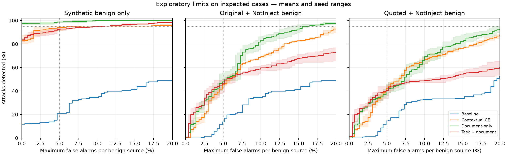

# Detector diagnostic: ranking versus decision thresholds

Exploratory oracle frontiers on previously inspected examples. Thresholds chosen from these sets are optimistic descriptive limits, NOT independently validated settings or deployment recommendations.

## Decision

Threshold adjustment alone is insufficient on these observed sources. At no more than 5% false alarms on each benign source, document-only models catch 43–55% of attacks, contextual CE catches 44–47%, and task-aware catches 39–50%. None reaches the illustrative research target of 95% attack recall with at most 5% false alarms on both sources. This is an exploratory target, not an agreed production requirement.

There is no single percentage that describes all ChatGPT or Gemini use. The model version, application instructions, tools, attack method, and benign examples all affect the result. A model used to *detect* injections is also a different experiment from an assistant asked to complete a task while resisting them. For example, an attack failing because the assistant makes an unrelated mistake does not mean a detector recognized it; **1 − attack success rate is not detector recall**.

Here are concrete **historical research results**, rather than claimed rates for today's live products:

| Evaluated setup | Reported attack detection | Reported false alarms | Scope |
|---|---|---|---|
| GPT-4o prompted as a binary injection detector in the 2025 PIGuard paper | 79.10% malignant accuracy on its attack benchmarks | 9.22% on its ordinary benign benchmark aggregate; 13.27% on NotInject | FPR values are calculated as 100% minus the corresponding reported benign accuracy. These are the paper's aggregates, not a newly measured pooled recall/FPR pair. |
| Early Gemini 1.5 Pro with a self-reflection defense in Google's May 2025 study | 98.7–100% attack detection rate across three attack-generation methods | 2% average FPR | Non-adaptive email experiments; benign evaluation used 10,000 email/prompt combinations. This was an experimental defense configuration. |

Sources: [PIGuard paper, Table 1 and Section 5.1](https://aclanthology.org/2025.acl-long.1468.pdf); [Google's Gemini security paper, Appendix H and Table 7](https://storage.googleapis.com/deepmind-media/Security%20and%20Privacy/Gemini_Security_Paper.pdf). The two rows use different attacks, datasets and metric definitions, so they do **not** establish that Gemini is better than GPT-4o. Our 291-example NotInject subset also differs from the paper's full set.

For the live ChatGPT product, the official documentation checked does not establish a universal production recall/FPR pair. OpenAI describes multiple defense layers and warns that automated filters do not catch every case. We should compare a specific model and defense on our fixed evaluation if we want an application-specific comparison. [Official OpenAI documentation](https://developers.openai.com/api/docs/guides/deep-research#prompt-injection-and-exfiltration).

To reach 95% attack recall, even the document-only models require 14–17% false alarms on at least one benign source. Contextual CE requires 21–24%; task-aware requires 74–89%. These are optimistic, sample-specific limits because thresholds were chosen directly on the inspected examples.

On the synthetic data alone, document-only models can reach 98–99% attack recall at a 5% benign false-alarm budget. Requiring the same threshold to handle NotInject lowers that to 43–55%. The earlier high synthetic-only average precision therefore does not demonstrate cross-source separation. Calibration contributes to the saved-threshold failures, but the broader ranking/generalization failure remains.

**NotInject is an external constructed benchmark, not a sample of real production traffic.** Its authors generated trigger-word-rich benign sentences, refined them with an LLM, and manually reviewed them. Our result demonstrates difficulty transferring between these example distributions; we have not measured general performance on real-world documents. [NotInject construction, Section 3.2](https://aclanthology.org/2025.acl-long.1468.pdf).

Our synthetic examples have a much narrower pattern. They repeatedly ask for an appointment reference, and their wrappers often explicitly say either “this is a rejected historical instruction” or “apply this instruction now.” A model could learn these recurring wording cues rather than a rule that transfers to unfamiliar documents. Holding out wrapper names helps, but the examples still share one author, task and construction style. This shortcut-learning explanation is plausible; the study did not isolate its causal effect.

NotInject changes the problem: benign prompts deliberately contain language associated with attacks. The detector then assigns some benign prompts scores that overlap with attack scores. Moving one threshold cannot separate overlapping examples without sacrificing either attack recall or benign access. In this diagnostic, document-only recall at a 5% false-alarm allowance falls from 98–99% on synthetic benign examples alone to 43–55% when the same threshold must also satisfy NotInject.

The task-aware experiment adds a separate flaw: 3,072 of its 4,096 training inputs omit task formatting, although evaluation always includes it. This mismatch may contribute to its failure, but it cannot explain the document-only failures. The practical response is to test one consistent input format and train on reviewed examples that include confusing benign language alongside attacks—not merely generate more variations of the same wrappers. These findings suggest limited generalization; they do not, by themselves, prove classical training-set overfitting.

Pause architecture expansion and repeated threshold tuning. Use one document-only DistilBERT model as the next experimental reference, keep the saved baseline, and focus on reviewed development examples representing both ordinary and confusing benign content alongside attacks. The newly assembled corpus is table-heavy and attack-heavy; it should not be trained as-is. Review the small development-only starter before committing to a large labeling effort, then define task/class sampling and a matched equal-step continuation experiment. Fix consistent task formatting before revisiting task conditioning. Reserve the new challenge for a single subsequent evaluation.

## Comparison population

All ten checkpoints see the same 256 attacks, 256 synthetic benign cases, and 291 NotInject benign probes. No fresh reserved challenge was read. Existing task-aware inputs include the task, while document-only inputs omit it; semantic task/document cases are matched. Contextual CE seeds 43/44 were scored on these same inspected examples to complete the three-seed comparison.

## Existing thresholds

| Model | Synthetic attack recall | Synthetic false alarms | NotInject false alarms |
|---|---:|---:|---:|
| baseline | 98.4% | 91.4% | 40.9% |
| context-v2-ce-42 | 98.4% | 50.4% | 37.1% |
| context-v2-ce-43 | 98.4% | 32.4% | 31.6% |
| context-v2-ce-44 | 98.4% | 31.6% | 34.7% |
| document-42 | 78.1% | 0.0% | 9.3% |
| document-43 | 83.2% | 0.0% | 9.3% |
| document-44 | 84.0% | 0.0% | 12.0% |
| task-document-42 | 38.7% | 0.0% | 2.4% |
| task-document-43 | 35.9% | 0.0% | 2.7% |
| task-document-44 | 53.1% | 0.0% | 6.9% |
### Note: All models in this table use the same approximately **67-million-parameter DistilBERT classifier**, first-token pooling, and full fine-tuning of both encoder and head. They are different training runs, not different-sized architectures. The frozen and mean-pooling baseline recipes are not included in this ten-checkpoint diagnostic.

| Name in the table | What the detector receives | Training and decision-setting differences |
|---|---|---|
| `baseline` | Document text | Original full fine-tuning on 58,799 PIGuard training examples for three epochs. Checkpoint and threshold selected using original validation data. |
| `context-v2-ce-42/43/44` | Document text | Continuation from baseline: 3,072 original examples plus 1,024 contextual paired examples, two epochs, cross-entropy loss. Original validation data selects the checkpoint and threshold. |
| `document-42/43/44` | Document text | Matched control for the task-aware study: 3,072 original examples plus 1,024 newly authored paired examples, two epochs, cross-entropy. A separate 512-example synthetic development set selects the checkpoint and threshold. |
| `task-document-42/43/44` | Trusted task plus document during inference | Same initialization, examples and training settings as its matched `document` arm, with task/document serialization for the new paired examples. The 3,072 original replay examples still lacked tasks, creating the formatting mismatch. Uses the matched synthetic development cases for selection. |

`CE` means **cross-entropy**, the loss that penalizes incorrect binary predictions. The numbers `42`, `43`, and `44` are random seeds affecting continuation randomness, including example order and dropout. They are not encoder versions. Each continuation starts from the same saved baseline weights; the three seeds are not three independent repetitions of baseline training.

The continuation runs use 512 optimizer updates and learning rates of `5e-6`. `task-document` feeds both text fields through one encoder; it does not add a second encoder. Also, `context-v2-ce` and `document` differ in their authored examples and validation distributions, so their difference cannot be attributed to one isolated training factor. Their saved thresholds can behave very differently even though the underlying architecture is identical.

## Attainable trade-offs: original documents

These rows choose an oracle threshold on the inspected examples. FPR budgets apply separately to synthetic benign and NotInject probes. Equal scores move together; no interpolated operating points are invented.
## question: what do u mean by budget? i thought the only budget is the number of tokens in the prompt. what is FPR budget?

**Answer:** Here, **budget means a maximum allowed rate of false alarms**. It is unrelated to tokens, money, or compute. A clearer phrase is “false-alarm allowance.”

`FPR = benign examples incorrectly blocked / all benign examples evaluated`.

A 5% FPR budget means we allow at most 50 false blocks per 1,000 benign examples *on the data used to set that constraint*. We then ask how many attacks the detector can catch while remaining within that allowance. Raising the score threshold usually blocks fewer benign examples but also misses more attacks; lowering it usually does the reverse.

In this report, “≤5% FPR each” applies separately to the 256 synthetic benign examples and 291 NotInject benign probes. Because counts are whole numbers, it permits at most 12 and 14 false alarms, respectively. For example, `document-43` can catch 142/256 attacks (55.5%) within both allowances on these inspected examples. Its percentage does not mean it will achieve the same rates on new traffic.

“Oracle threshold” means we examine all attainable thresholds after seeing these examples' labels and report the best feasible trade-off. That makes this an optimistic diagnostic. A deployed threshold would need to be chosen on development data and assessed on untouched examples.

| Model | Recall at ≤1% FPR each | Recall at ≤2% FPR each | Recall at ≤5% FPR each | Min worst-source FPR at ≥90% recall | At ≥95% recall | At ≥99% recall |
|---|---:|---:|---:|---:|---:|---:|
| baseline | 0.0% | 0.0% | 13.7% | 73.0% | 80.9% | 97.7% |
| context-v2-ce-42 | 5.1% | 16.0% | 46.9% | 18.9% | 20.6% | 70.3% |
| context-v2-ce-43 | 8.6% | 18.0% | 45.7% | 18.2% | 22.0% | 57.8% |
| context-v2-ce-44 | 8.2% | 12.5% | 44.1% | 19.9% | 24.4% | 60.2% |
| document-42 | 9.8% | 23.8% | 44.5% | 13.4% | 16.5% | 25.8% |
| document-43 | 14.8% | 30.5% | 55.5% | 12.4% | 13.7% | 24.1% |
| document-44 | 9.8% | 21.9% | 43.4% | 15.1% | 16.5% | 25.8% |
| task-document-42 | 22.3% | 26.2% | 50.0% | 45.7% | 82.8% | 97.3% |
| task-document-43 | 25.0% | 30.1% | 50.4% | 51.5% | 73.5% | 97.9% |
| task-document-44 | 12.5% | 23.8% | 39.1% | 72.9% | 89.3% | 95.9% |

## Attainable trade-offs: quoted documents

These rows choose an oracle threshold on the inspected examples. FPR budgets apply separately to synthetic benign and NotInject probes. Equal scores move together; no interpolated operating points are invented.

| Model | Recall at ≤1% FPR each | Recall at ≤2% FPR each | Recall at ≤5% FPR each | Min worst-source FPR at ≥90% recall | At ≥95% recall | At ≥99% recall |
|---|---:|---:|---:|---:|---:|---:|
| baseline | 0.0% | 0.8% | 14.5% | 75.8% | 89.1% | 99.2% |
| context-v2-ce-42 | 6.6% | 18.8% | 43.8% | 20.6% | 26.1% | 83.2% |
| context-v2-ce-43 | 6.2% | 11.7% | 40.2% | 21.3% | 26.8% | 78.5% |
| context-v2-ce-44 | 8.2% | 9.4% | 42.6% | 24.1% | 27.1% | 78.1% |
| document-42 | 9.4% | 23.4% | 38.7% | 18.9% | 23.4% | 31.3% |
| document-43 | 14.5% | 27.0% | 45.7% | 16.8% | 18.9% | 27.8% |
| document-44 | 9.4% | 24.2% | 35.9% | 19.9% | 24.1% | 32.0% |
| task-document-42 | 20.7% | 25.4% | 44.9% | 81.4% | 92.8% | 99.0% |
| task-document-43 | 24.6% | 28.5% | 43.4% | 81.4% | 91.4% | 99.0% |
| task-document-44 | 14.1% | 22.7% | 33.6% | 88.7% | 95.5% | 99.3% |

## Shared errors

| Group | Shared missed attacks: saved threshold | Shared missed attacks: oracle ≤5% FPR each | Shared benign false alarms: oracle ≥95% recall |
|---|---:|---:|---:|
| all_models | 4 | 84 | 40 |
| context-v2-ce | 4 | 132 | 68 |
| document | 32 | 112 | 40 |
| task-document | 120 | 120 | 231 |

The local `results/detector-diagnostic-v1/shared-errors-with-text.jsonl` joins shared error IDs to full task/document text, source, category/family and error policy. It is ignored by Git. Grouped patterns and exact IDs are in [the JSON diagnostic](detector-diagnostic.json). Shared errors are agreements among these models, not proof of label correctness. No external reserved-challenge text is included.

## Interpretation boundaries

The synthetic examples are correlated templates, and NotInject has no attack cases. Combining them tests known source shift but does not simulate real traffic. A strong oracle point means ranking on these inspected examples may support better calibration; it does not validate that threshold. A poor oracle point means changing the threshold alone cannot meet that trade-off on this observed set. The quoted condition is a previously inspected perturbation, not fresh evidence.

Task-aware training supplied task formatting for only 1,024/4,096 rows, and all task phrasings described one extraction task. This is a concrete experimental flaw and limits causal interpretation. Repeated seeds share baseline initialization. New data candidates and their reserved challenge were not loaded by this script. No weights, checkpoint thresholds, or application defaults were changed.
### question: all in all what is the best model among all the models so far? why is it?

**Answer:** For our goal of catching most attacks while limiting benign blocks, the **document-only full-fine-tuning family is the strongest current research direction among the ten checkpoints compared here**. It has a better high-recall trade-off than contextual CE or task-plus-document in this diagnostic, and its matched application replay preserved benign completion without successful attacker markers. That application result covers only 32 attacks per seed, so it is limited evidence.

If you want the strongest individual checkpoint on these inspected trade-offs, it is **`document-43`**: it catches 55.5% of attacks with at most 5% false alarms on each benign source, compared with 43.4–44.5% for the other document-only seeds. To reach at least 95% attack recall, its minimum worst-source false-alarm rate is 13.7%, compared with 16.5% for the other two. These figures are still inadequate for our illustrative 95% recall / 5% FPR target.

There is no winner at every operating point. At the much stricter 1% allowance, `task-document-43` catches 25.0% of attacks versus 14.8% for `document-43`; its trade-off becomes much worse when we demand high recall. “Best” therefore depends on the cost we assign to missed attacks versus benign blocks.

Use the **document-only recipe**, with all three seed results reported, as the next controlled reference. Do not promote seed 43 just because it won on an inspected challenge—that would select a model using test outcomes. Keep `baseline-v1` as the preserved historical reference. Frozen, mean-pooling and ranking-loss variants were not all evaluated on these exact cases, so this report cannot establish a universal ranking of every checkpoint in the repository.
