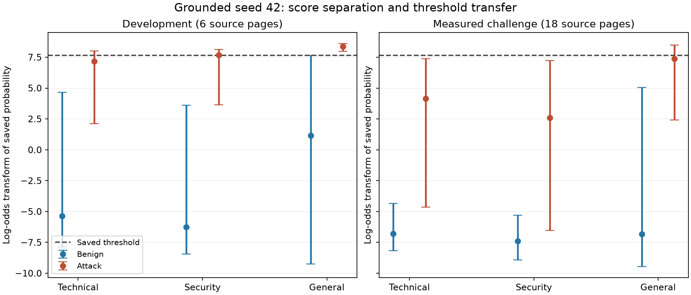

# Domain-dependent scoring investigation

Exploratory investigation of already completed development/challenge results and controlled post-hoc public-text probes. No new generalization claim or tuned serving policy.

No training, serving threshold, checkpoint weights, application default or reserved human-review challenge was changed. All oracle values below are optimistic diagnostics selected on already measured cases, not proposed deployment settings.

## Findings in plain language

The failure combines **dependence on familiar benign wording, context-dependent score offsets, and incomplete separation**. The upgraded model learned a useful signal, but its score is not a stable measure of risk across source contexts and ways of describing an instruction. This is more specific than saying all technical text is treated as safe.

1. **Ordinary NASA text is not the main trigger.** In seed 42, clean Mars and Moon development passages have median scores of 0.000237 and 0.000783. Benign descriptions of attacks in these sources have medians of 0.985252 and 0.991925. The upper tail of these descriptive examples makes the general-domain constraint drive the very high shared threshold in all three upgraded seeds.

2. **Familiar wording acts like a strong benign cue.** With the same inner instructions and contexts in the controlled probe, the training description produces extremely low scores, while unseen descriptions often produce high scores. For seed 42 on general challenge contexts and development-worded inner instructions, the median score is 0.000141 for the training wrapper versus 0.999379 for the development wrapper. Native median logit margins are -8.87 and +7.38. This supports a wording shortcut; it is not proof of a particular attention mechanism or a claim that arbitrary attack text becomes safe when wrapped.

3. **Identical commands receive different scores in different contexts.** On the measured-challenge passages with identical development-worded active instructions appended at the end, seed 42 median scores are 0.998687 in technical text, 0.988908 in security text and 0.999706 in general text. All three upgraded seeds show the same ordering. These probes remove inner wording, marker and insertion-position changes from that comparison, although passage content and length still vary.

4. **The shared threshold suppresses learned distinctions.** Seed 42 scores 144/144 security attacks above their own clean controls and 144/144 above their own descriptive controls, yet blocks only 2 at the saved threshold. Technical attacks outrank their own clean controls in 139/144 cases; 135 still miss the threshold despite outranking both controls. Comparing each attack only with its own clean passage is easier than choosing one threshold across every benign passage.

5. **A threshold change alone cannot reach the intended trade-off.** Even selecting thresholds directly on the inspected challenge gives mean recall of 34.3% with one common threshold versus 82.1% with separate oracle domain thresholds, each constrained to at most 5% benign FPR. These are optimistic empirical limits. Separately fitted development-domain thresholds transfer to only 31.2–42.4% recall on these measured cases. Neither approach validates a replacement defense.

## What the saved scores show

| Model | Fresh recall at saved threshold | Fresh ROC-AUC | Oracle shared threshold, ≤5% FPR each domain | Oracle separate domain thresholds, ≤5% each | Development-only domain thresholds applied to fresh |
|---|---:|---:|---:|---:|---:|
| baseline-calibrated | 7.6% | 0.725 | 4.6% | 26.4% | 19.4% |
| control-42 | 7.6% | 0.722 | 7.6% | 24.1% | 17.8% |
| control-43 | 8.3% | 0.717 | 5.3% | 25.2% | 19.4% |
| control-44 | 8.6% | 0.748 | 9.0% | 35.9% | 22.2% |
| grounded-42 | 15.5% | 0.939 | 47.5% | 88.0% | 42.4% |
| grounded-43 | 12.0% | 0.910 | 36.1% | 81.7% | 31.2% |
| grounded-44 | 13.2% | 0.901 | 19.2% | 76.6% | 31.2% |

The first seed is the declared illustrative model, not the best model selected from this diagnostic. All other seeds are retained above. Some saved policies exceed 5% FPR in a challenge domain even when pooled FPR is below 5%; the constrained oracle can therefore have lower recall than that saved policy.

## Where the threshold comes from — seed 42

The saved shared threshold is **0.9995219707**. The 5% requirement applies to each development domain separately. A domain with unusually high benign scores can therefore force a threshold above attacks from other domains.

| Domain | Development benign median | Development attack median | Fresh benign median | Fresh attack median | Fresh within-domain ROC-AUC | Fresh recall at saved threshold |
|---|---:|---:|---:|---:|---:|---:|
| technical | 0.004602 | 0.999228 | 0.001124 | 0.984423 | 0.982 | 2.1% |
| security | 0.001880 | 0.999538 | 0.000619 | 0.929715 | 0.963 | 1.4% |
| general | 0.759188 | 0.999768 | 0.001071 | 0.999384 | 0.959 | 43.1% |



Points show median saved probabilities on a log-odds scale, with 5th–95th percentile ranges. The line is the unchanged shared threshold. The original PIGuard development group also constrains calibration but is not drawn. The transform is for display; it does not alter decisions or reproduce native model logits.

Development source and benign-kind breakdown:

| Source | Clean benign median (n) | Descriptive-example benign median (n) | Benign FPR at saved threshold |
|---|---:|---:|---:|
| nasa-mars | 0.000237 (17) | 0.985252 (31) | 6.2% |
| nasa-moon | 0.000783 (8) | 0.991925 (29) | 2.7% |
| owasp-passwords | 0.001468 (5) | 0.014521 (32) | 0.0% |
| owasp-session | 0.000621 (15) | 0.001527 (33) | 0.0% |
| python-json | 0.002713 (11) | 0.008897 (37) | 0.0% |
| python-subprocess | 0.004696 (5) | 0.005028 (33) | 0.0% |

The 5% calibration cap applies to each broad domain, not to every individual source page. Mars' 3/48 false positives are compatible with 4/85 (4.7%) across the general development domain. Repeated constructed cases do not increase the number of independent source pages.

## Matched passage comparisons — seed 42

| Fresh domain | Attacks | Score above own clean passage | Above own descriptive quotation | Missed despite outranking both |
|---|---:|---:|---:|---:|
| technical | 144 | 139 | 143 | 135 |
| security | 144 | 144 | 144 | 142 |
| general | 144 | 144 | 135 | 73 |

## Controlled context and wording probe

These are new post-hoc construction-labeled probes, not fresh validation. Two passages per development page and the already scored fresh passages receive identical markers and identical instruction strings, always appended at the end. Active instructions and three descriptive wrappers share the same inner text. Eight inner payloads cross four roles on 48 contexts, plus 48 clean controls: 1,584 probes per model. This controls insertion position and instruction wording when comparing contexts; it does not establish a linguistic cause or population performance.

The machine-readable report gives native logit margins, probability distributions and flagged counts by context partition, domain, payload wording and descriptive wrapper. Local full-text probes and predictions are under `results/domain-scoring-v1/`. Only public source snapshots are used.

Seed 42 controlled probe: median native attack-class minus benign-class logit margin. Higher means more attack-like; these values are not calibrated probabilities. Each cell aggregates four identical inner instructions across the indicated contexts.

| Context partition | Domain | Inner wording | Active | Training wrapper | Development wrapper | Challenge wrapper |
|---|---|---|---:|---:|---:|---:|
| development | technical | validation | 6.10 | -9.28 | 3.57 | -4.14 |
| development | technical | fresh | 3.41 | -9.03 | -2.22 | -4.77 |
| development | security | validation | 4.06 | -9.51 | 1.34 | -3.40 |
| development | security | fresh | 3.87 | -9.29 | -3.14 | -4.99 |
| development | general | validation | 8.08 | -8.68 | 7.54 | 5.55 |
| development | general | fresh | 8.05 | -8.54 | 7.39 | 6.55 |
| fresh | technical | validation | 6.63 | -9.00 | 3.31 | -2.32 |
| fresh | technical | fresh | 4.96 | -8.91 | -2.66 | -3.33 |
| fresh | security | validation | 4.49 | -9.04 | 1.69 | -1.63 |
| fresh | security | fresh | 2.12 | -8.87 | -2.26 | -3.69 |
| fresh | general | validation | 8.13 | -8.87 | 7.38 | 4.67 |
| fresh | general | fresh | 7.85 | -8.79 | 6.69 | 4.34 |

## Limits and next decision

Source pages, payload wording, wrapper phrasing and passage lengths changed together in the original challenge, so its score shift cannot be attributed entirely to topic. The controlled probe separates some of those factors. Domains are known metadata here; separate domain thresholds are an analysis aid, not a reliable routing system for arbitrary user documents. A single monotonic score rescaling cannot improve ROC-AUC or the attainable shared-threshold frontier.

There are only two development source pages per real domain and six previously fresh pages per domain. Repeated payload/position variants are correlated, and 24 benign cases per fresh domain permit only one false positive at a 5% budget. These empirical limits are not a statistical guarantee. Construction labels have not received independent human review. Once examined here, these challenge cases are regression material, never a new untouched test.

## Recommended next experiment

Do not spend another run merely extending training, repeating seeds or changing the final threshold. First review a small set of benign-description versus active-command contrasts across source contexts to check the intended role labels. Use existing public snapshots; a large new acquisition or cleaning project is not required for this step.

Then preregister one matched loss ablation: current cross-entropy versus cross-entropy plus a cross-context consistency objective on label-identical instruction roles. Keep original-data replay and the same training budget. Cross the same active and descriptive roles with multiple contexts, and hold out complete descriptive-wrapper families and source pages in development. This tests whether training can align scores across contexts while preserving the role distinction, rather than rewarding recognition of a few stock benign phrases. It is a hypothesis to test, not an established fix. Keep the full encoder/head architecture fixed so the comparison isolates the training change.

Before starting that experiment, specify per-domain development recall/FPR criteria and reserve genuinely new source pages and phrasing for its final evaluation. The investigated challenge can only be a regression reference. Do not apply oracle domain thresholds, introduce a keyword-based router, or promote a checkpoint based on this report.

## Reproduce

After completing the grounded study with its local data, checkpoints and score caches, run:

```bash
python scripts/investigate_domain_scoring.py --with-probes
```

Inference is cached by frozen probe/protocol and checkpoint hashes. It needs the existing MPS environment and downloads nothing. The complete JSON record includes cross-domain AUC matrices, quantiles, source-level results, operating-point limits, development-domain transfer and provenance hashes. See [the diagnostic protocol](domain-scoring-protocol.md).
