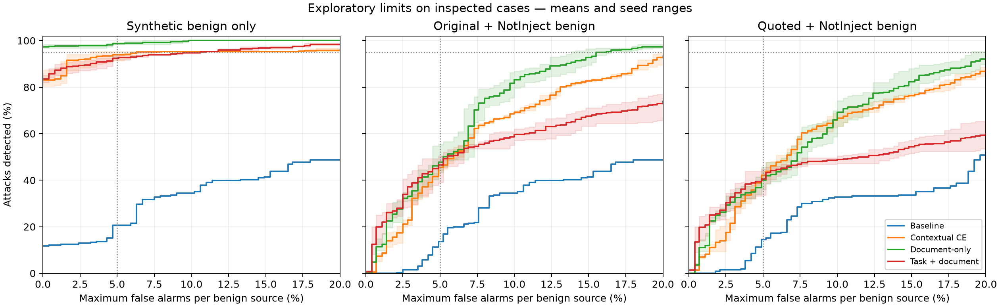

# Detector trade-offs — diagnostic report

**Assessment:** Threshold changes alone cannot meet the illustrative 95%-recall/5%-FPR target on these inspected sources.

## Design

The diagnostic compared ten approximately 67M-parameter full-fine-tuned checkpoints on identical 256 attacks, 256 authored benign cases and 291 NotInject probes. Attainable thresholds kept ties intact and constrained FPR separately on each benign source; the quotation condition reused a previously inspected perturbation. These challenge-selected oracle points are optimistic diagnostic limits.

## Results

| Family | Oracle recall at ≤5% FPR each | Minimum worst-source FPR at ≥95% recall |
|---|---|---|
| Baseline | 13.7%–13.7% | 80.9%–80.9% |
| Contextual CE | 44.1%–46.9% | 20.6%–24.4% |
| Document only | 43.4%–55.5% | 13.7%–16.5% |
| Task + document | 39.1%–50.4% | 73.5%–89.3% |

## Decision and limitations

Use document-only as the historical controlled direction; do not select a winning seed on inspected challenge results. Source shift and the task-formatting flaw require controlled follow-up.

NotInject contains no attacks; the mixture is artificial and templates are correlated. The frozen/mean recipes are outside this matched ten-model comparison. ASR complements are not detector recall.

**Records:** [Measured record](../records/detector-diagnostic.json). Detailed rationale and chronology: [research diary](../../research_diary.md).
